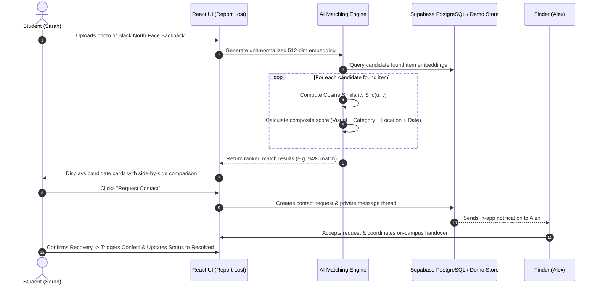

# LOSTANDFOUND AI — Smart Lost & Found Platform with AI Image Matching


**LOSTANDFOUND AI** is an intelligent, privacy-first web application designed to help campus and municipal communities recover lost belongings through computer vision, high-dimensional neural image embeddings, and multi-signal candidate ranking.

Instead of browsing text boards with vague descriptions, users upload or select a photograph of a lost item. The platform's AI pipeline computes mathematically rigorous **Cosine Similarity** over normalized feature embeddings to surface visually similar found items, accounting for variations in lighting, angle, and background.

---

## 🌟 Key Highlights & Innovations

- **AI-Powered Image Matching**: Employs 512-dimension unit-normalized vector embeddings ($\|\mathbf{v}\|_2 = 1.0$) and dot-product cosine similarity:
  $$\text{Cosine Similarity}(\mathbf{u}, \mathbf{v}) = \frac{\mathbf{u} \cdot \mathbf{v}}{\|\mathbf{u}\|_2 \|\mathbf{v}\|_2}$$
- **Multi-Signal Composite Ranking**: Dynamically blends visual cosine similarity with category alignment, geographic location proximity, and temporal decay:
  $$S_{\text{composite}} = \frac{w_{\text{visual}} \cdot S_{\text{visual}} + w_{\text{category}} \cdot S_{\text{category}} + w_{\text{location}} \cdot S_{\text{location}} + w_{\text{date}} \cdot S_{\text{date}}}{\sum w}$$
- **Pluggable AI Provider Architecture**: Switch between:
  1. `GeminiMultimodalEmbeddingProvider` (Google Gemini Vision API)
  2. `EdgeFunctionEmbeddingProvider` (Supabase Edge Functions for secure server-side inference)
  3. `DeterministicDemoEmbeddingProvider` (Zero-cloud deterministic high-dimensional feature vectors with pre-seeded campus items)
- **Side-by-Side Visual Comparison Inspector**: Inspect the reported lost photograph beside candidate found-item photos with interactive zoom and multi-signal feature breakdown.
- **End-to-End Privacy Guard**: Personal phone numbers and email addresses are never exposed to strangers. Inquiries and verification happen within an authenticated in-app messaging thread with a celebratory confirmation handover workflow.
- **Role-Based Admin Moderation Console**: Moderation queue to review, approve, or flag public listings and prevent spam or illicit items.
- **Interactive Demo Switcher**: Instant 1-click persona switcher (Sarah Chen [Student], Alex Rivera [Finder], Officer Marcus [Admin], Guest) with realistic seeded campus items (North Face Backpack, Hydro Flask, AirPods Pro 2, University ID Card, Apple USB-C Charger, Keys, Wallet, Sunglasses, Patagonia Jacket, Textbook).

---

## 🛠️ Technology Stack

| Layer | Technologies |
|---|---|
| **Frontend** | React 18, TypeScript, Vite, React Router v6 |
| **Styling & UI** | Tailwind CSS, Lucide Icons, Canvas Confetti |
| **Database & Auth** | Supabase PostgreSQL, Row Level Security (RLS), Supabase Auth |
| **Storage** | Supabase Storage (`item-photos` bucket) |
| **AI Inference** | Google Gemini Multimodal Embeddings / Supabase Edge Functions |
| **Testing** | Vitest (Automated unit tests for math, ranking, & validation) |

---

## 🚀 Quickstart & Local Development

### 1. Prerequisites
- **Node.js**: v18.0.0 or higher (v20+ recommended)
- **npm** or **pnpm** / **yarn**

### 2. Clone the Repository
```bash
git clone https://github.com/naaneshwarn/LOSTANDFOUND.git
cd lostfound
```

### 3. Install Dependencies
```bash
npm install
```

### 4. Configure Environment Variables
Copy `.env.example` to `.env`:
```bash
cp .env.example .env
```
*(Note: If you leave `.env` empty or omit Supabase credentials, the application automatically launches in **Interactive Demo Mode** with realistic seeded data).*

### 5. Start the Development Server
```bash
npm run dev
```
Open [http://localhost:5173](http://localhost:5173) in your browser.

---

## 🧪 Automated Testing

Run the automated Vitest test suite covering vector normalization, cosine similarity math, and multi-signal ranking:

```bash
npm test
```

To run with coverage or in watch mode:
```bash
npx vitest watch
```

---

## 🗄️ Database Architecture & Supabase Setup

### Database Tables
1. `profiles`: User accounts, avatars, roles (`user`, `moderator`, `admin`), obfuscated contact.
2. `lost_items`: Lost item reports, categories, locations, dates, photos, rewards.
3. `found_items`: Discovered items, location, verification marks, safe contact method, approval status.
4. `image_embeddings`: High-dimensional vector representations (`vector(512)` / `jsonb`), model metadata, image hash.
5. `match_results`: Candidate similarity scores, composite scores, user feedback (`potential_match`, `not_a_match`, `contact_requested`).
6. `contact_requests`: Inbound/outbound claim requests with status lifecycle (`pending`, `accepted`, `rejected`, `cancelled`).
7. `messages`: Authenticated in-app private conversation thread between participants.
8. `notifications`: In-app notification alerts for match discoveries and messages.
9. `item_status_history`: Audit trail for state changes and recoveries.

### Applying Migrations
1. Open your Supabase project dashboard at [https://supabase.com](https://supabase.com).
2. Go to **SQL Editor** -> **New Query**.
3. Paste the contents of `supabase/migrations/20261019000000_init_lost_and_found.sql` and run.
4. (Optional) Run `supabase/seed.sql` to populate sample campus listings in PostgreSQL.
5. Go to **Storage** -> **New Bucket**, name it `item-photos`, and toggle **Public Bucket** to ON.

---

## 🧠 AI Image Matching Pipeline Architecture



---

## 🌐 Deploying to Vercel

1. Push your repository to GitHub (`https://github.com/naaneshwarn/LOSTANDFOUND.git`).
2. Log into [Vercel](https://vercel.com) and click **Add New Project**.
3. Import your `LOSTANDFOUND` repository.
4. Under **Environment Variables**, add:
   - `VITE_SUPABASE_URL`
   - `VITE_SUPABASE_ANON_KEY`
   - `VITE_AI_PROVIDER`
   - `VITE_GEMINI_API_KEY`
5. Click **Deploy**. Vercel will build and serve your application globally on high-speed CDN edge nodes.

---

## 🛡️ Security & Privacy Principles

- **No Public PII Exposure**: Student email addresses, phone numbers, and physical dorm rooms are strictly withheld.
- **PostgreSQL Row Level Security**: Users can only edit or delete items they created. In-app messages are accessible only to the two verified participants in the claim request.
- **Admin Verification**: High-risk or flagged listings can be hidden by authorized campus safety moderators.
- **Safe Handover Protocol**: Encourages handovers at designated campus safety desks or student union drop-off lockers.

---

## 📄 License
This project is open-source under the MIT License.
